# AgroTrends — Architecture and features (launch)

How the launch features work and how they connect. **Exists** = on `development` today; a roadmap number
(e.g. `6.4`) = planned for the launch (`docs/ROADMAP.md`). The product reasons are in `docs/PLAN.md`.
Diagrams are Mermaid (rendered by GitHub and IntelliJ).

---

## 1. System context

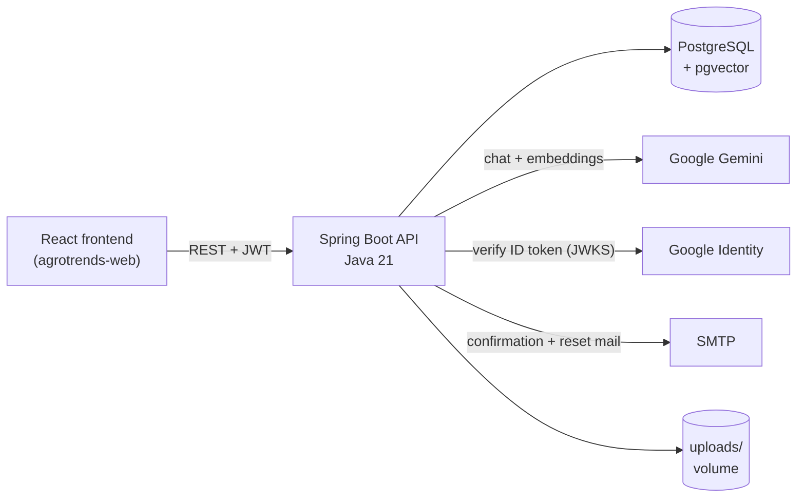

- One deployable, one database. The vector store is a pgvector table in the same Postgres, so a post and
  its vectors live side by side.
- Gemini is the only paid external dependency. Every AI call is behind quotas (§8.5).

## 2. Code layout

`controllers` → `service` → `repositories` → `entities`. Controllers take `model.request` records and return
`model.response` records wrapped in `HttpResponse`; entities never leave the service layer. Security lives in
`security/` (JWT filter, sessions, `AuthorizationService`, `AttemptLimiter`). Conventions:
`.claude/skills/coding-conventions`, `api-conventions`, `security-checklist`.

Cross-cutting rules every feature below follows:

| Rule | Where |
|---|---|
| Caller identity comes from the token, never the body | `AuthUtil`, every service |
| Mutations are owner-or-admin | `AuthorizationService.assertOwnerOrAdmin` |
| Writes need a confirmed e-mail (5.7) | One check in the service layer, 403 `EMAIL_NOT_VERIFIED` |
| User HTML is sanitised on the way in (5.9) | jsoup safelist in the services that store HTML |
| Side effects (notifications, indexing, reputation totals) run after commit | Spring events, §9 |

## 3. Domain map

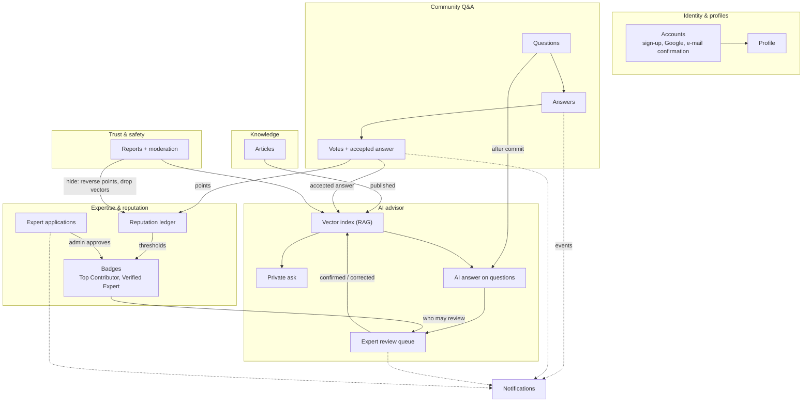

The arrows into **Vector index** are the learning loop: only published articles and vetted answers get in
(decision 15).

## 4. Data model (launch)

New tables are marked with the roadmap step that adds them.

```mermaid
erDiagram
    USER ||--|| PROFILE : has
    USER ||--o{ USER_SESSION : "signs in"
    USER ||--o{ EMAIL_VERIFICATION_TOKEN : "5.6"
    USER ||--o{ BLOG : writes
    USER ||--o{ QUESTION : asks
    USER ||--o{ ANSWER : writes
    USER ||--o{ VOTE : "casts (6.4)"
    USER ||--o{ REPUTATION_EVENT : "earns (6.6)"
    USER ||--o{ EXPERT_APPLICATION : "submits (7.1)"
    USER ||--o{ EXPERT_BADGE : "holds (7.2)"
    USER ||--o{ NOTIFICATION : "receives (8.1)"
    USER ||--o{ REPORT : "files (8.3)"
    USER ||--o{ AI_ANSWER : "private asks"
    CATEGORY ||--o{ BLOG : topic
    CATEGORY ||--o{ QUESTION : "topic (6.1)"
    CATEGORY ||--o{ EXPERT_BADGE : "scope"
    CATEGORY ||--o{ REPUTATION_EVENT : "scope"
    BLOG }o--o{ TAG : tagged
    QUESTION }o--o{ TAG : "tagged (6.1)"
    QUESTION ||--o{ ANSWER : has
    QUESTION ||--o| QUESTION_AI_ANSWER : "7.3"
    QUESTION |o--o| ANSWER : "accepted (6.5)"
    EXPERT_BADGE ||--o{ QUESTION_AI_ANSWER : "reviews"

    QUESTION {
        long id
        string title
        text content
        long categoryId
        json agri "crop, season, region, soil"
        list imageUrls "6.2"
        int score "6.4"
        long acceptedAnswerId "6.5"
        bool hidden "8.4"
    }
    ANSWER {
        long id
        text content
        int score "6.4"
        bool expertAnswer "7.4"
        bool hidden "8.4"
    }
    VOTE {
        long userId
        string targetType "QUESTION or ANSWER"
        long targetId
        int value "+1 or -1"
    }
    REPUTATION_EVENT {
        long userId
        long categoryId
        int points
        string reason "UPVOTED, ACCEPTED, ..."
        string sourceType
        long sourceId
        bool reversed
    }
    EXPERT_APPLICATION {
        long userId
        list categoryIds
        string fieldTitle "e.g. Veterinarian"
        string credentialType
        string institution
        list proofImageUrls
        string status "PENDING, APPROVED, REJECTED"
        string reviewNote
    }
    EXPERT_BADGE {
        long userId
        long categoryId
        string fieldTitle
        long grantedBy
        datetime revokedAt
    }
    QUESTION_AI_ANSWER {
        long questionId
        text answer
        json sources
        string status "UNCHECKED, CONFIRMED, CORRECTED, FLAGGED"
        long reviewedBy
    }
    NOTIFICATION {
        long recipientId
        string type
        string targetType
        long targetId
        datetime readAt
    }
    REPORT {
        long reporterId
        string targetType
        long targetId
        string reason
        string status "OPEN, ACTIONED, DISMISSED"
    }
```

Today the profile is the `Author` entity (only created for `AUTHOR` sign-ups). 5.5 makes it every user's
profile. Vectors live in Spring AI's pgvector table, keyed by metadata (`blogId` today, `questionId` +
`answerId` from 7.6), not by a foreign key.

---

## 5. Identity and profiles

### 5.1 Accounts and e-mail confirmation (exists; 5.5–5.7)

Sign-up (e-mail + password) or Google sign-in. **One account type** (5.5): `userType` disappears from
sign-up and every user gets a profile. Nothing that writes works until the e-mail is confirmed (5.7).

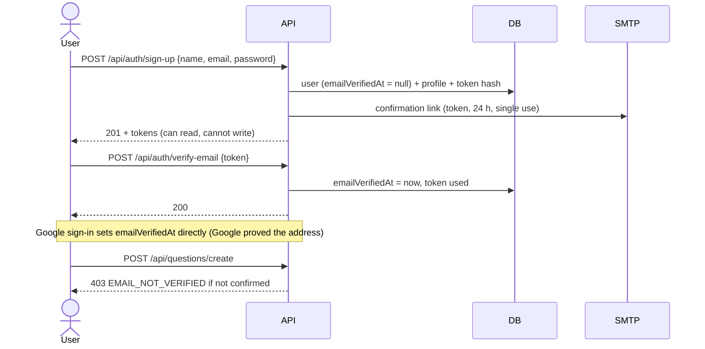

- Reuses the password-reset token design (hash stored, single use) and `MailService`.
- `POST /api/auth/resend-verification` is rate-limited with `AttemptLimiter`.
- `UserResponse.emailVerified` (exists) lets the frontend show a banner.

**Connects to:** every write in §6–§8 checks confirmation. The AI quota is per account, so confirmation is
also what stops bots from farming Gemini spend.

### 5.2 Sessions (exists)

15-minute JWT checked against a `UserSession` row; rotating single-use refresh tokens; sign-out revokes.
Bans (8.4) revoke every session of the user.

### 5.3 Profile (exists; extended in 5.5, 6.7, 7.2)

Public profile: name, field, institution, bio, specialities, image, and from launch **reputation per topic**
and **badges**. It is what a student shows employers.

---

## 6. Knowledge: articles (exists)

Drafts → publish, slugs, reading time, tags, images, categories, agri metadata, full-text search, claps,
bookmarks, follows, feeds (latest / following / trending). Launch changes: any confirmed user may publish
(5.5); HTML sanitised (5.9); list endpoints return excerpts (5.10).

**Connects to:** publishing indexes the article into the vector store; unpublish/delete removes it (§8.2).

---

## 7. Community Q&A, votes, reputation, badges

### 7.1 Questions and answers (exists; 6.1–6.3)

A question carries a **topic** (category, required: it routes the question to the right experts), tags,
crop / season / region / soil, and up to 4 photos. Answers are threaded. Launch adds search, `answerCount`
and an `unanswered` filter.

### 7.2 Votes and the accepted answer (6.4, 6.5)

- `PUT /api/votes {targetType, targetId, value: +1|-1}`, `DELETE` to take it back. One vote per user per
  target; voting on your own post is refused; a downvote needs 50 points.
- `score` is updated with an atomic `UPDATE ... SET score = score + :delta` (same pattern as claps).
- `POST /api/questions/id/{id}/accept/{answerId}`: asker only; one accepted answer; can be changed.

### 7.3 Reputation ledger (6.6–6.7)

Every point is a row in `REPUTATION_EVENT`, scoped to the question's topic. Totals per user and topic are
derived (and cached). Taking a vote back, changing the accepted answer, or a moderator hiding the post
**reverses** the matching rows, so totals stay correct without recomputing history.

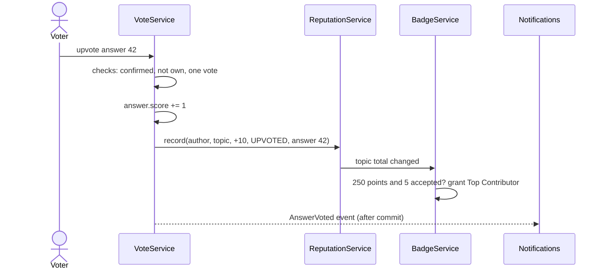

| Event | Answer author | Question author |
|---|---|---|
| Upvote on answer / question | +10 | +5 |
| Downvote on answer / question | −2 | −2 |
| Answer accepted | +15 | +2 |
| Post hidden by moderator | all its events reversed | all its events reversed |

### 7.4 Badges (6.8, 7.2)

| Badge | Source | Stored as |
|---|---|---|
| Top Contributor (topic) | Computed from the ledger: ≥ 250 points and ≥ 5 accepted answers in that topic | Derived; no table |
| Verified Expert (topic) | Admin approval of an application | `EXPERT_BADGE` row per topic, revocable |

Question and answer responses carry the author's reputation in that topic and their badges, so the UI can
rank and mark answers without extra calls.

### 7.5 Expert verification (7.1, 7.2)

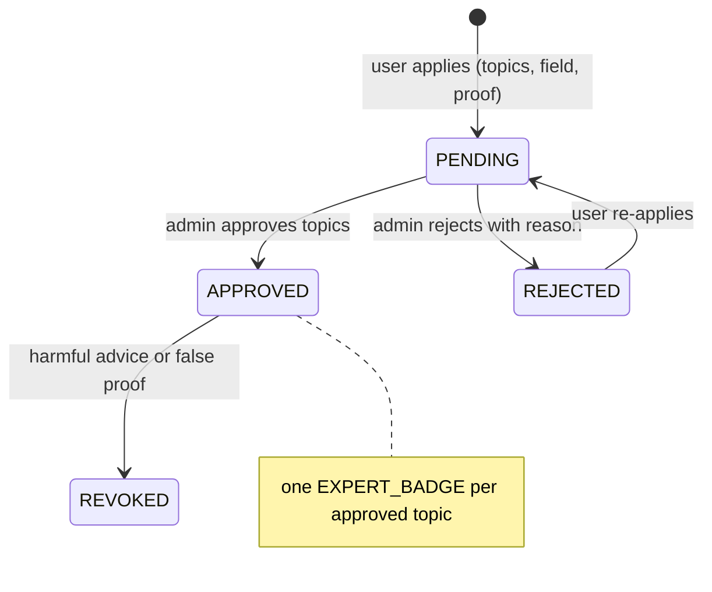

- Proof images use the existing image upload. They are visible to admins and the applicant only.
- Approval can grant fewer topics than requested.
- Each decision sends a notification (8.1).

---

## 8. AI advisor

### 8.1 What the AI may learn from

| Content | Indexed? | When removed |
|---|---|---|
| Published article | Yes (exists) | Unpublish, delete, hide |
| Accepted answer | Yes (7.6) | Un-accepted, deleted, hidden |
| Answer by a Verified Expert in the question's topic | Yes (7.6) | Deleted, hidden, badge revoked |
| AI answer confirmed or corrected by an expert | Yes, the confirmed text or the correction (7.6) | Reopened, hidden |
| Unchecked or flagged AI answer, drafts, comments | **Never** | — |

### 8.2 Indexing pipeline (exists for articles; 7.6 for answers)

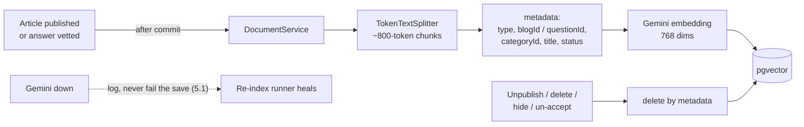

### 8.3 Private ask (exists; 7.5)

`POST /api/ai/ask` → retrieval (top 5, similarity ≥ 0.7, published/vetted only) → Gemini with the chunks
framed as untrusted context → answer + `sources` (articles today; questions too from 7.6). History is
private. **"Ask an expert to check this"** (7.5) turns the private ask into a public question, which then
follows §8.4.

### 8.4 AI answer on every question and the review queue (7.3, 7.4)

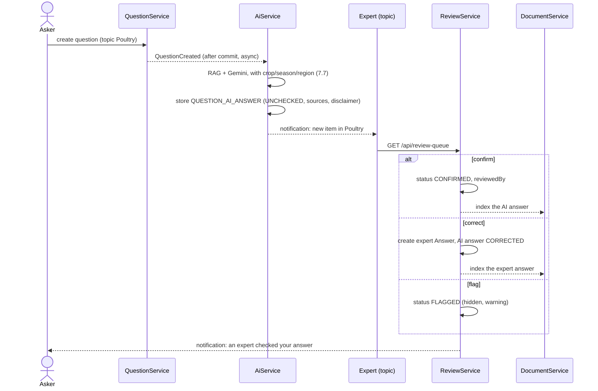

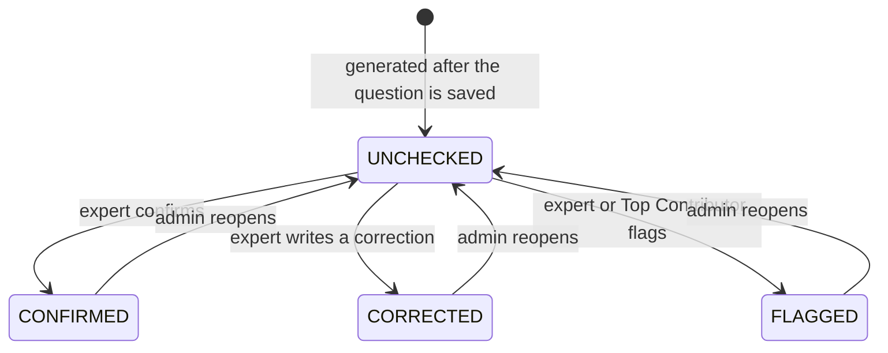

- Only Verified Experts **in the question's topic** can confirm or correct. Top Contributors can flag.
- The first decision wins; an admin can reopen.
- If Gemini fails, the question is still saved; the AI answer is retried by a scheduled job or left absent.
- Every AI answer response carries the `disclaimer` text (label dose, local agriculture office, 16123).
- The old on-demand `POST /api/questions/id/{id}/ai-draft` is retired in 7.3.

### 8.5 Cost limits

Per-user daily quota (20, exists), per-IP daily cap (5.8), 1000-character question cap, 60 s timeout, 503 on
failure. One AI answer per question, generated once. Rough cost: $0.004–0.012 per answer (product study §3.3).

---

## 9. Events and notifications (8.1, 8.2)

Services publish plain Spring events. Listeners run **after the transaction commits**, so a rolled-back
write never notifies or indexes anything.

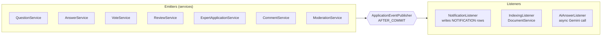

| Event | Notification to | Also triggers |
|---|---|---|
| QuestionCreated | Verified Experts in the topic (once the AI answer exists) | AI answer generation |
| AnswerCreated | Question author | — |
| AnswerAccepted | Answer author | Index the answer |
| AiAnswerReviewed | Question author | Index if confirmed/corrected |
| ApplicationDecided | Applicant | — |
| CommentReplied | Parent comment author | — |
| ContentHidden | Content author | Drop vectors, reverse reputation |

No self-notifications. `/api/notifications` is caller-only: list, unread count, mark read.
`shortcut:` in-process events; move to a broker or outbox when a second consumer or app instance exists.

## 10. Trust and safety (8.3, 8.4)

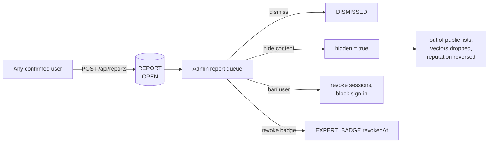

Report targets: article, question, answer, AI answer, comment, user. One report per user per target. Admin
actions are audited (`AuditModel`).

## 11. Endpoint map (launch additions)

| Area | Endpoints (new unless marked) | Step |
|---|---|---|
| Auth | `POST /api/auth/verify-email`, `POST /api/auth/resend-verification`; sign-up loses `userType` | 5.5–5.6 |
| Questions | `GET /api/questions/search?q=`, `?categoryId=&tag=&unanswered=true` on `/all` | 6.1–6.3 |
| Votes | `PUT /api/votes`, `DELETE /api/votes/{targetType}/{targetId}` | 6.4 |
| Accept | `POST /api/questions/id/{id}/accept/{answerId}`, `DELETE /api/questions/id/{id}/accept` | 6.5 |
| Reputation | `GET /api/users/{id}/reputation` | 6.7 |
| Experts | `POST /api/experts/applications`, `GET /api/experts/applications/me` | 7.1 |
| Admin: experts | `GET /api/admin/expert-applications?status=`, `POST .../{id}/approve`, `POST .../{id}/reject`, `DELETE /api/admin/expert-badges/{id}` | 7.2 |
| AI on questions | `GET /api/questions/id/{id}/ai-answer` | 7.3 |
| Review queue | `GET /api/review-queue`, `POST /api/review-queue/{id}/confirm`, `.../correct`, `.../flag`, admin `.../reopen` | 7.4 |
| AI ask | `POST /api/ai/history/{id}/ask-expert` | 7.5 |
| Notifications | `GET /api/notifications`, `GET /api/notifications/unread-count`, `POST /api/notifications/{id}/read`, `POST /api/notifications/read-all` | 8.2 |
| Reports | `POST /api/reports`; admin `GET /api/admin/reports`, `POST /api/admin/reports/{id}/action` | 8.3–8.4 |

Paths follow `api-conventions`. A step may refine a path; the step's DEV_LOG entry records the final contract.
